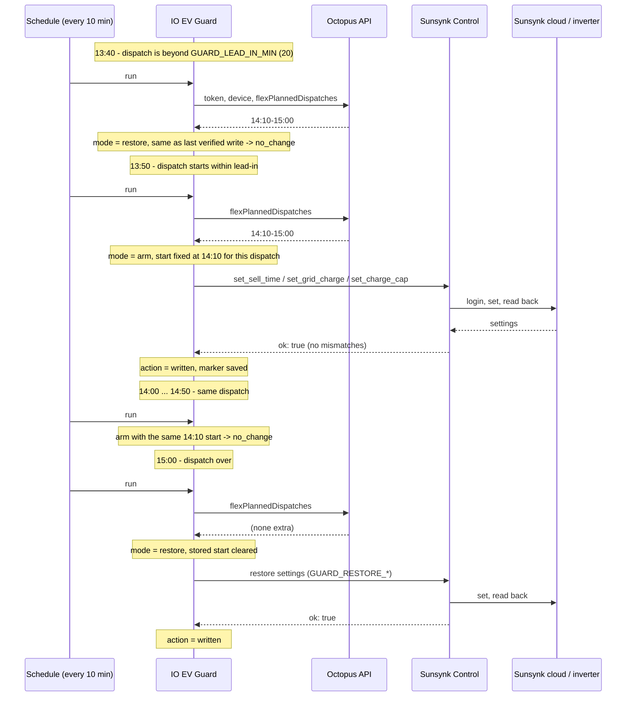

# Overview

This page explains the ideas behind the toolkit and how the three workflows work together. For setup, see [installation.md](installation.md).

## Concepts

### Intelligent Octopus dispatches
Intelligent Octopus (IO) controls when your EV or charger draws power. Its planned charging periods are called *dispatches*, and Octopus publishes them through its GraphQL API as `flexPlannedDispatches`, each with a `start` and an `end`. Most fall in the normal off-peak window (23:30–05:30 by default, `GUARD_OFFPEAK_START` / `GUARD_OFFPEAK_END`).

Some fall outside it. While those run, the house is billed at the cheap rate. The guard calls the part of a dispatch outside the off-peak window an **extra** dispatch. If a dispatch overlaps the window, only the parts outside it count.

### Sunsynk timer slots
A Sunsynk hybrid inverter has six timer slots. Each slot has:
- a start time (`sellTimeN`, `HH:MM`). A slot runs until the next slot's start, so slot N's start is slot N-1's end and the times must stay in order.
- a grid charge switch (`timeNOn` / `timeNon`). When it's on, the battery can charge from the grid during that slot.
- a battery target (`capN`, a state-of-charge percentage).
- on some firmware, a per-slot Sell enable flag (`sellTimeNEn`).

The slots have no date. A slot set to 14:00 applies at 14:00 every day.

### Grid charge during an extra dispatch
If the battery's slot at 14:00 lets it discharge, it powers the house and the car during an afternoon extra dispatch, even though grid power is cheap then. The guard switches grid charge on for one slot (`GUARD_SLOT`), starting when the dispatch starts, with a target of `GUARD_CAP_SOC`. The battery then holds or charges instead. When the dispatch ends, the guard puts the slot back to your restore settings.

### Sell (export)
The optional Evening Sell workflow sets one slot (`SELL_SLOT`) to start at `SELL_START`, with grid charge off and the target set to `SELL_FLOOR_SOC`. The idea is that the battery exports in the evening down to that floor. What the inverter actually does with these settings depends on its work mode and firmware. **TBD:** not checked on a live inverter.

## How the workflows interact

- **Sunsynk Control** is the only workflow that talks to the Sunsynk cloud. It's a webhook. Each request carries one command, and Control checks it, logs in, writes it and reads it back.
- **IO EV Guard** runs every 10 minutes. It reads Octopus, decides between arm, restore and hold, and sends three commands to Control when something needs to change.
- **Evening Sell** runs at 17:55 every day and sends three (or four) commands to Control.

The guard and Sell use different slots, and Sell refuses to run if `SELL_SLOT` equals `GUARD_SLOT`. See the per-workflow pages:
- [workflows/io-ev-guard.md](workflows/io-ev-guard.md)
- [workflows/evening-sell.md](workflows/evening-sell.md)
- [workflows/sunsynk-control.md](workflows/sunsynk-control.md)

## One dispatch, from arm to restore

The example below uses an extra dispatch from 14:10 to 15:00, writes turned on, and the plug gate off.

If the dispatch is already running when it's first seen, the armed start is the current time, rounded to the minute in `GUARD_TIMEZONE`, and it stays fixed until the dispatch ends.
